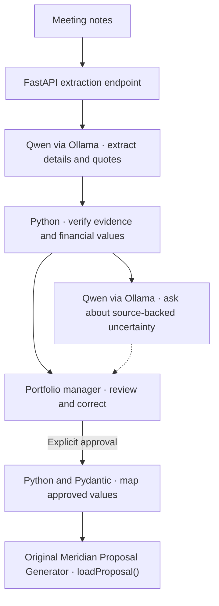

# Meridian AI Proposal Assistant

Meridian is an AI agent that helps portfolio managers prepare investment proposals
from meeting notes. The notes can be incomplete, contain competing financial
figures, or describe decisions the client still needs to confirm.

Qwen extracts proposal details and cites the supporting passages. Python checks
the evidence and financial values, and unresolved decisions stay visible for
the portfolio manager to review. After the manager approves the review,
Meridian opens an editable draft in the supplied Meridian Proposal Generator.

## Architecture



Built with Python, FastAPI, Pydantic, local Qwen 2.5 3B via Ollama, and HTML,
CSS and JavaScript for the browser, with pytest and Playwright for testing.

FastAPI serves the workspace and the unchanged generator on the same origin.
The PM retains control of investment decisions and the final proposal.
[Review and handoff details](docs/integration.md)

## Getting started

Use Python 3.12, Ollama and a browser. The commands below are for Windows
PowerShell. The initial dependency and model downloads require internet access.

Start Ollama in a separate window if it is not already running:

```powershell
ollama serve
```

From the repository root, pull the model if needed, install the app and start
FastAPI:

```powershell
ollama pull qwen2.5:3b
python -m venv .venv
.\.venv\Scripts\python.exe -m pip install -e ".[dev]"
.\.venv\Scripts\python.exe -m uvicorn meridian_agent.app:app --host 127.0.0.1 --port 8000
```

Open the [local workspace](http://127.0.0.1:8000/). The app defaults to Ollama on
loopback and reads process environment variables. [Environment settings](.env.example)

## Using Meridian

1. Paste meeting notes, then select **Extract proposal details**.
2. Open **View evidence** to check a figure against the notes. Confirm an estimate,
   correct a value or defer a decision. Any clarification questions appear beside
   the relevant field.
3. Confirm the reviewed values and select **Approve & generate draft**. The draft
   opens in the [original Meridian Proposal Generator](web/vendor/challenge-generator.html)
   for editing.

The [fictional retirement notes](challenge/sample-inputs/01-notes-retiree-income.txt)
describe about ZAR 6.2 million in capital and roughly ZAR 28,000 in monthly
income. Check both passages and confirm the capital estimate before approving.

## Testing and limitations

With the development dependencies installed, install Chromium once and run
the offline suite:

```powershell
.\.venv\Scripts\python.exe -m playwright install chromium
.\.venv\Scripts\python.exe -m pytest -m "not llm" -q
```

The offline suite passed 234 tests, including browser checks for evidence,
PM corrections and duplicate draft prevention. The suite uses deterministic
model responses so it can run without Ollama.

Live extraction took about 53–64 seconds in two local rehearsals. Clarification
added about 30 seconds in one of those runs. The PM can continue reviewing
while questions load. Qwen can miss details or skip relevant questions, and
unresolved financial values require PM review before they can enter a draft.

The workflow accepts typed or pasted text, including an existing transcript.
Audio transcription is outside the current scope.
